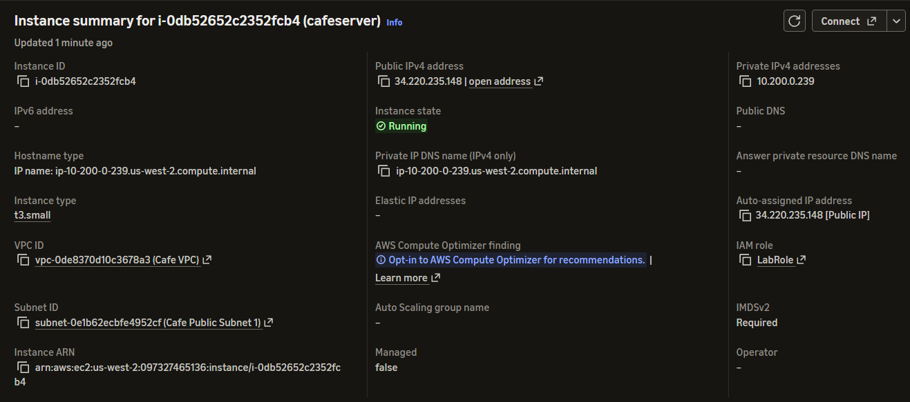
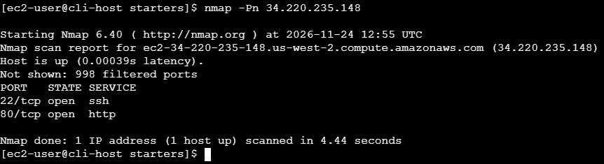
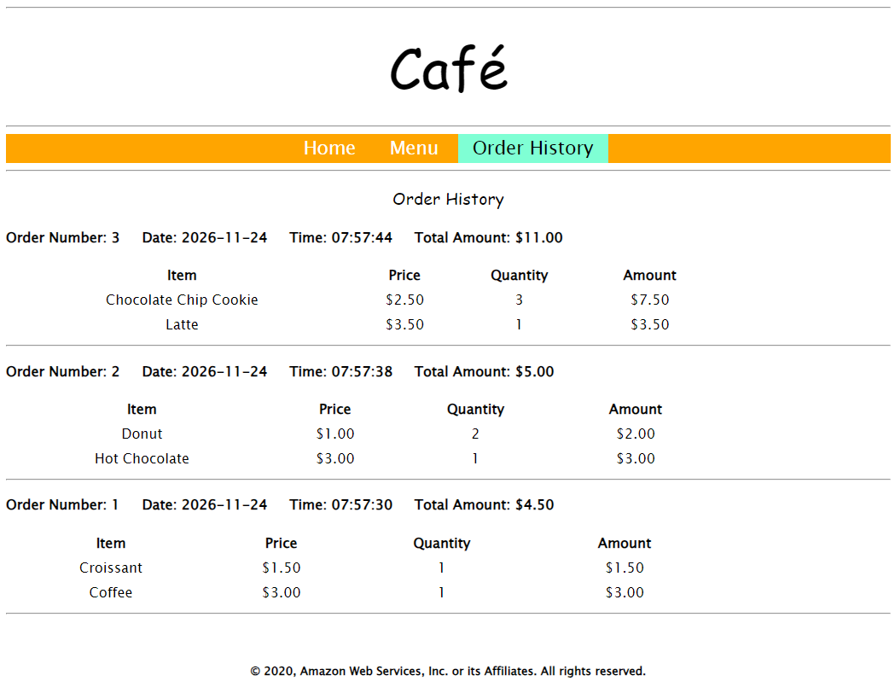

# Lab 173 - Solução de problemas na criação de uma instância EC2

## Visão geral

Neste laboratório, foi realizada a solução de problemas na criação e configuração de uma instância Amazon EC2 por meio da AWS CLI. A atividade envolveu a identificação e correção de falhas no provisionamento, além do diagnóstico de conectividade e validação de uma aplicação web.

## Objetivos

- Utilizar a AWS CLI para criar uma instância EC2.
- Identificar e corrigir erros durante a criação da instância.
- Investigar problemas de conectividade com a ferramenta Nmap.
- Verificar a configuração e o funcionamento de uma aplicação web.

## Atividades realizadas

### 1. Criação da instância EC2

Utilização da instância CLI Host para executar comandos da AWS CLI e iniciar o provisionamento da instância `cafeserver` por meio de um script.

### 2. Identificação e correção de erros

Análise de falhas no processo de criação da instância, incluindo o erro `InvalidAMIID.NotFound`, relacionado à identificação da AMI utilizada no script.

### 3. Diagnóstico de conectividade

Investigação da indisponibilidade da aplicação web, utilizando o Nmap para verificar as portas acessíveis e consultando os registros de inicialização da instância.

### 4. Validação da aplicação

Acesso à aplicação Café pelo navegador e realização de pedidos para verificar seu funcionamento e o registro das informações no histórico de pedidos.

## Evidências

### 1. Detalhes da instância EC2

Instância `cafeserver` criada durante o laboratório.

### 2. Diagnóstico com Nmap

Verificação das portas disponíveis na instância EC2.

### 3. Aplicação Café

Histórico de pedidos após a realização dos testes na aplicação.

## Página do projeto

[Acessar GitHub Pages](https://brunogacarvalho.github.io/lab-173-troubleshooting-ec2/)

A página apresenta um resumo do laboratório e 8 flashcards interativos para revisar os principais conceitos abordados.

## Créditos

Laboratório realizado durante a formação em Computação em Nuvem (AWS re/Start) da **Escola da Nuvem**.

- Professor: [Raphael Ohlsen](https://br.linkedin.com/in/raphael-ohlsen)
- Instituição: [Escola da Nuvem](https://escoladanuvem.org/) | [LinkedIn da Escola da Nuvem](https://www.linkedin.com/school/escola-da-nuvem/)

Laboratório realizado como parte da formação em Computação em Nuvem AWS.
